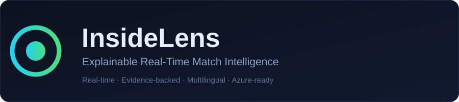

# InsideLens

**Explainable real-time tactical intelligence for football.**
Built for *Inside the Game: Developer Hackathon* (Microsoft × Premier League).




InsideLens turns a synthetic, football-realistic event stream into **explainable match
intelligence**: as events arrive it explains *why* key moments and tactical patterns
happened — with an evidence graph, weighted contributing factors, a confidence score,
and a **counterfactual** ("what would have changed the outcome"). Every explanation is
delivered in multiple languages for studios, broadcasters and fans.

Pick any two of the **20 Premier League clubs** from the **2026/27** season (real squads,
colours and stadiums) and watch the fixture come to life on the **live pitch** — all 22
players move with the ball, a fading trail follows the ball, action arrows show passes and
shots, and goals trigger an on-pitch celebration. The default is **Manchester United vs
Manchester City**.

> Most systems tell you *what* happened. InsideLens tells you **why**, and shows its work.

---

## Why it's different

| Typical match tool | InsideLens |
|---|---|
| Score, xG, possession counters | Adds **causal explanations** for every key moment |
| "City scored, 2-1" | "…from a move worth 0.34 xG after 9 passes; the decisive factor was a high turnover; the chance was created against a defensive line that had faced 3 shots in 10 min" |
| Black-box model output | **Evidence-backed**: each claim cites the exact event ids and metric deltas |
| One language | **Multilingual narratives** (EN/ES/FR/PT/AR/ZU) via Azure Translator or an offline template engine |
| A flat feed | **Automated highlights** ranked by an explainable excitement score |
| Same view for everyone | **Personalized experiences** for fans, studios and broadcasters |
| Static dashboards | **Streaming WebSocket** live experience + on-demand full analysis API |
| Raw event log | **Expanded analytics dataset** (engineered features) + Fabric/Azure SQL persistence |

### Capabilities (mapped to the hackathon brief)

- **Analyze match events in real time** — streaming WebSocket pipeline.
- **Generate stories, highlights, and recaps** — `engine/highlights.py`, `engine/narrative.py`.
- **Explain key moments and tactical patterns** — evidence graph, weighted factors, counterfactuals.
- **Expand datasets for AI and analytics** — `store/dataset.py` (28 engineered features, JSONL/CSV/Parquet/Delta export).
- **Insights in multiple languages** — 6 languages, online or offline.
- **Personalized experiences** — `engine/personas.py` (fan / studio / broadcaster personas).

Three explainability pillars are attached to **every** insight:

1. **Weighted factors** — normalised contributions that sum to 1.
2. **Evidence graph** — human-readable evidence items referencing concrete event ids.
3. **Counterfactual** — the single change that would most alter the outcome.

---

## Architecture

```
                  ┌──────────────────────────────────────────────────────────┐
live feed      →  │  MatchPipeline (async orchestrator)                       │
(EventSource)     │                                                           │
                  │   SyntheticSource ▸ EventHubSource ▸ ReplaySource         │
                  │        │                (pluggable, lazy Azure deps)       │
                  │        ▼                                                  │
                  │   MatchAnalytics  (possession, xG, momentum, field tilt,  │
                  │                    press intensity, flanks)               │
                  │        │                                                  │
                  │        ▼                                                  │
                  │   Pattern engine  (high press, low block, transitions,    │
                  │                    overloads, sustained pressure, set plays)│
                  │        │                                                  │
                  │        ▼                                                  │
                  │   Explanation engine → Insight(factors, evidence,         │
                  │                                  confidence, counterfactual)│
                  │        │                                                  │
                  │        ▼                                                  │
                  │   LLM client (Azure OpenAI ▸ local template fallback)     │
                  │   + i18n layer (Azure Translator ▸ offline templates)     │
                  └──────────────────────────────────────────────────────────┘
                                     │ WebSocket + REST
                                     ▼
                          Live web dashboard (pitch, momentum,
                          active patterns, live feed, insight cards)
```

### Azure-ready by design
The system runs **with zero cloud keys** and swaps to Azure services without code changes:

| Component | Local default | Azure-ready adapter |
|---|---|---|
| Live feed | `SyntheticSource` / `ReplaySource` | **Azure Event Hubs** (`EventHubSource`) |
| Narrative LLM | `app/llm/local.py` (templates) | `app/llm/azure.py` → **Azure OpenAI / Microsoft Foundry** |
| Translation | `app/engine/narrative.py` (offline templates) | **Azure AI Translator** (`app/llm/translator.py`) |
| Insight persistence | `app/store/repository.py` (in-memory) | **Azure SQL Database** (`AzureSqlInsightRepository`) |
| Analytics dataset | `store/dataset.py` → JSONL/CSV/Parquet/Delta | **Microsoft Fabric / OneLake** (`FabricOneLakeRepository`) |

Set `INSIDELENS_LLM_PROVIDER=azure`, `INSIDELENS_TRANSLATOR_PROVIDER=azure`,
`INSIDELENS_DATA_SOURCE=eventhub` and the corresponding env vars to activate. Any
Azure call failure automatically falls back to the deterministic local engine, so the
demo never breaks on stage. See [`docs/AZURE_MAPPING.md`](docs/AZURE_MAPPING.md) for the
architecture mapping and [`docs/AZURE_EXERCISE.md`](docs/AZURE_EXERCISE.md) for a step-by-step
runbook. To exercise the integrations directly:

```powershell
python scripts/azure_smoke.py    # reports PASS / FALLBACK / SKIP per provider
```

---

## Quickstart

```powershell
python -m venv .venv
.\.venv\Scripts\Activate.ps1
pip install -r requirements.txt
copy .env.example .env        # optional; works without editing
uvicorn app.main:app --reload --port 8000
```

Open <http://127.0.0.1:8000> and press **▶ Play live**. Switch the **language**
selector and expand the insight cards to see per-card language chips.

### Run the tests

```powershell
pip install pytest
python -m pytest -q
```

---

## Developer workflow & GitHub Copilot

This repository is set up for AI-assisted development:

- **[`.github/copilot-instructions.md`](.github/copilot-instructions.md)** teaches GitHub
  Copilot the architecture, style rules and guardrails (offline-first, explainability,
  lazy Azure imports, Pydantic v2, no frontend build step) so suggestions match the codebase.
- **[`AGENTS.md`](AGENTS.md)** gives coding agents a quick map of "what lives where" and a
  definition of done.
- **[`.github/workflows/ci.yml`](.github/workflows/ci.yml)** runs the full `pytest` suite on
  every push and pull request (Python 3.11 and 3.12), proving the app builds and passes with
  **no Azure credentials**.
- **[`.github/workflows/azure-smoke.yml`](.github/workflows/azure-smoke.yml)** runs the Azure
  exercise on demand (`workflow_dispatch`) against repository secrets.

---

## Screenshots

Dashboard captures live in [`docs/screenshots/`](docs/screenshots/). The live view shows the
animated 22-player pitch, momentum graph, active tactical patterns, the streaming commentary
feed and evidence-backed insight cards.

---

## API

| Method | Path | Description |
|---|---|---|
| GET | `/` | Live dashboard |
| GET | `/api/health` | Status, active LLM/translator/store, languages |
| GET | `/api/teams` | The 20 selectable Premier League clubs |
| GET | `/api/analysis?seed=20261015&translate=true&home=MUN&away=MCI` | Full-match analysis: goals, patterns, highlights, final state |
| GET | `/api/highlights?seed=…&persona=…&home=…&away=…` | Ranked highlight reel (persona-aware) |
| GET | `/api/recap?seed=…&persona=…&home=…&away=…` | Localized, personalized full-time recap |
| GET | `/api/personalize?seed=…&persona=…&home=…&away=…` | Insights rewritten for a persona (language/tone/depth) |
| GET | `/api/personas` | Available personas |
| GET | `/api/dataset/export?seed=…&format=jsonl\|csv\|parquet\|delta&upload=false` | Expanded analytics dataset for ML/BI; `upload=true` pushes to Fabric OneLake |
| GET | `/api/store/stats` | Active storage backend + persisted insight count |
| WS | `/ws/live?seed=…&speed=…&persona=…&source=synthetic\|eventhub&home=…&away=…` | Real-time stream: `match_init`, `tick`, `insight`, `end` |

`home`/`away` are Premier League club ids (e.g. `MUN`, `MCI`, `ARS`, `LIV`); see `/api/teams`.

`speed` = simulated match-seconds replayed per real second (default 60 → a 90-minute
match in ~90 seconds).

### Example insight payload

```json
{
  "kind": "goal_explanation",
  "minute": 53,
  "team_id": "HOME",
  "confidence": 0.92,
  "factors": [{"name": "Build-up", "weight": 0.31, "direction": "supports"}],
  "evidence": [{"label": "Chance quality", "metric": "xg", "value": 0.34,
                "event_ids": [812, 813]}],
  "counterfactual": "Counterfactual: had RIV cleared the ball at minute 51 …",
  "translations": {"en": "…", "es": "…", "ar": "…"}
}
```

---

## Project layout

```
app/
  config.py            settings (Azure-ready, safe defaults)
  models.py            domain models (events, teams, insights, state)
  data/
    teams.py           Premier League club registry (20 clubs, squads, venues)
    simulator.py       deterministic synthetic match generator
  engine/
    metrics.py         pitch geometry + xG model
    analytics.py       incremental match analytics
    pitch.py           dynamic player positioning (22-player live pitch)
    patterns.py        tactical pattern detection
    highlights.py      ranked highlight reel
    explain.py         evidence graph, weighted factors, counterfactuals
    personas.py        personalization (fan/studio/broadcaster)
    narrative.py       multilingual narrative templates
    i18n.py            localization orchestration
    pipeline.py        async orchestrator + streaming
  llm/
    base.py            LLM interface
    local.py           offline template engine
    azure.py           Azure OpenAI / Microsoft Foundry client
    translator.py      Azure AI Translator client (+ local fallback)
    factory.py         provider selection
  store/
    dataset.py         dataset expansion + JSONL/CSV/Parquet/Delta export
    repository.py      insight persistence (memory / Azure SQL / Fabric OneLake)
    factory.py         storage backend selection
  data/sources.py      EventSource: synthetic / Event Hubs / replay
  main.py              FastAPI app + WebSocket
  static/              dashboard (HTML/CSS/JS)
scripts/
  azure_smoke.py       Azure exercise (live PASS/FALLBACK/SKIP per provider)
.github/
  copilot-instructions.md   GitHub Copilot repo guidance
  workflows/           CI (pytest) + on-demand Azure smoke
docs/                  Azure & Microsoft Fabric mapping, runbook, banner, screenshots
tests/                 sources, simulator, analytics, explainability, highlights,
                       personas, translator, dataset, store, pipeline, API, Azure (skipped offline)
```

## Reproducibility
The simulator is seeded (`INSIDELENS_MATCH_SEED`, default `20261015`), so demos and
tests are deterministic while any seed produces a fresh match. Set the default fixture
with `INSIDELENS_HOME_TEAM` / `INSIDELENS_AWAY_TEAM`, or pick teams live in the UI.

> Club names, colours and stadiums are real. Starting XIs follow each club's **2026/27
> most-used eleven**; player ratings are synthetic and the squads are a snapshot for the
> demo, not official team sheets.
